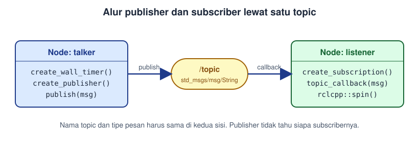
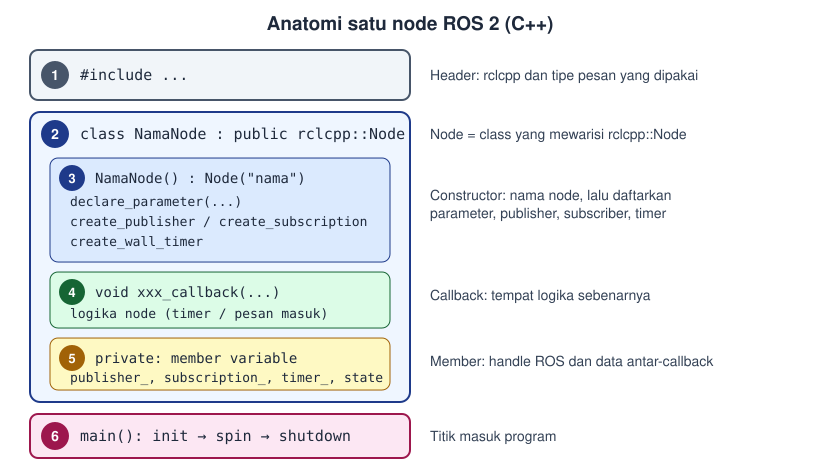
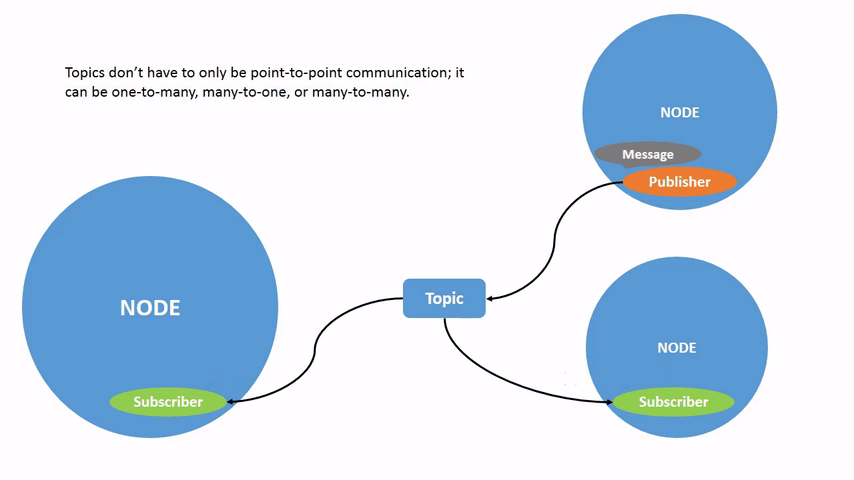
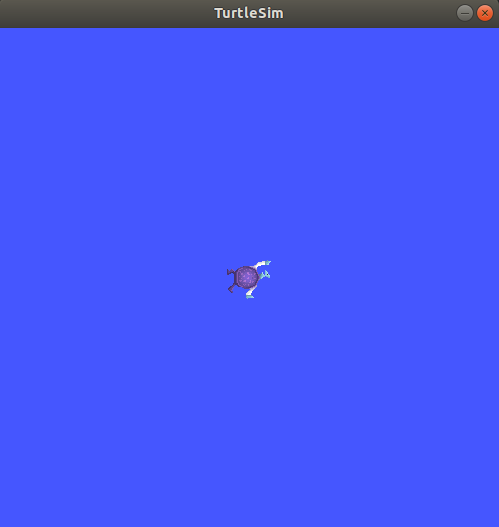
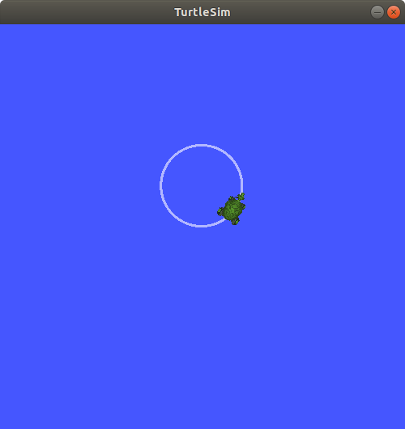
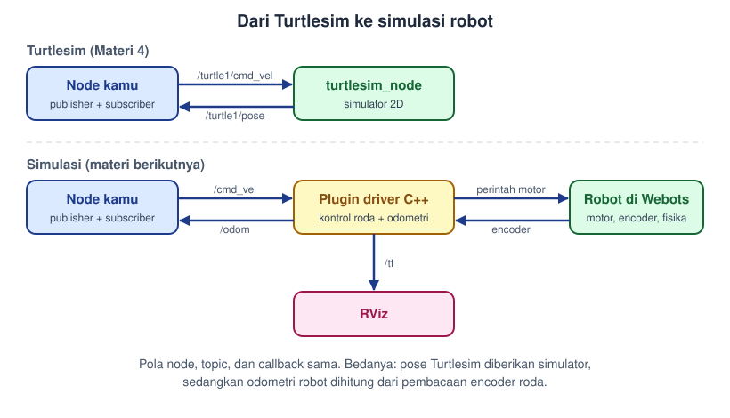
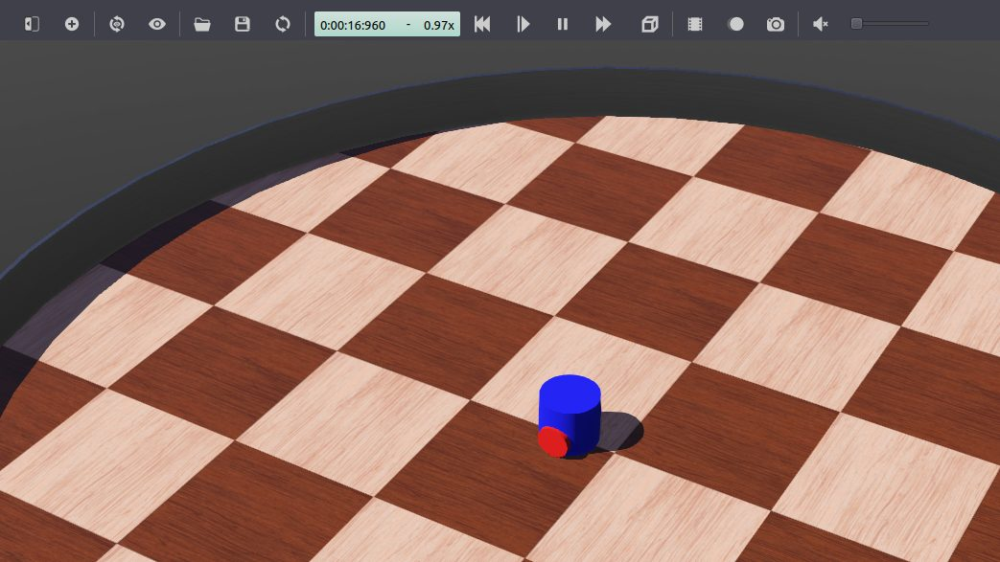
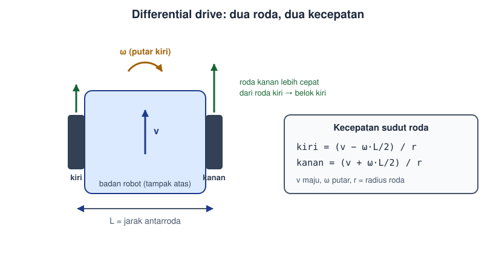
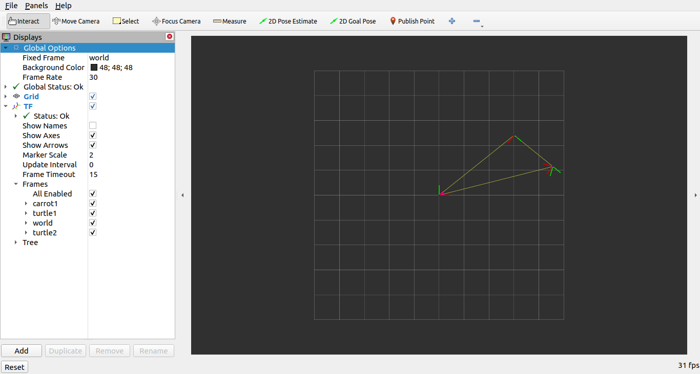
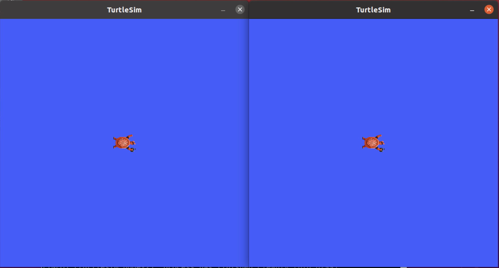

# Materi 4: Praktik ROS 2 (Publisher, Subscriber, dan Turtlesim)

**Programming Division — ITS Robocon Team 2025**

Di Materi 3 kita sudah memakai node dan topic bawaan lewat terminal. Materi ini mengajak kamu menulis node sendiri dengan C++: mulai dari publisher dan subscriber paling sederhana, lalu dipakai untuk mengendalikan kura-kura di Turtlesim.

> **Syarat:** ROS 2 Humble dan Turtlesim sudah terpasang (lihat Materi 3), serta kamu sudah paham class di C++ (lihat Materi 1). Setiap terminal baru harus menjalankan `source /opt/ros/humble/setup.bash` lebih dulu.
>
> **Catatan pengujian:** kode `talker` dan `listener` identik dengan contoh resmi ROS 2 Humble. Kode di Bagian B (`circle_driver`, `pose_listener`, `go_to_goal`) ditulis untuk modul ini dan belum diuji melalui build pada perangkat pengguna. Jika ada error, bandingkan dengan bagian Troubleshooting.

## Daftar Isi
~
1. [Tujuan Pembelajaran](#1-tujuan-pembelajaran)
2. [Persiapan: Workspace](#2-persiapan-workspace)
3. [Bagian A: Publisher dan Subscriber dari Nol](#3-bagian-a-publisher-dan-subscriber-dari-nol)
4. [Bagian B: Mengendalikan Turtlesim dengan Kode Sendiri](#4-bagian-b-mengendalikan-turtlesim-dengan-kode-sendiri)
5. [Ringkasan](#5-ringkasan)
6. [Troubleshooting](#6-troubleshooting)
7. [Menuju Materi Berikutnya: Simulasi](#7-menuju-materi-berikutnya-simulasi)
8. [Referensi](#8-referensi)

---

## 1. Tujuan Pembelajaran

Setelah materi ini, kamu mampu:

- Membuat workspace dan package ROS 2 (C++) dengan `colcon`.
- Menulis node publisher dan subscriber, lalu menjalankannya.
- Membaca dan memahami graf node-topic dengan `rqt_graph` dan `ros2 topic`.
- Mengirim perintah gerak (`geometry_msgs/msg/Twist`) dan membaca posisi (`turtlesim/msg/Pose`) dari kode sendiri.
- Membuat kontroler sederhana (go-to-goal) yang memakai publisher dan subscriber sekaligus.

---

## 2. Persiapan: Workspace

Workspace adalah folder tempat semua package milikmu berada. Kode selalu ditulis di dalam `src`.

```bash
mkdir -p ~/ros2_ws/src
cd ~/ros2_ws
```

Struktur yang akan kita bangun sepanjang materi ini:

```text
ros2_ws/
├── src/
│   ├── cpp_pubsub/        # Bagian A: talker dan listener
│   └── turtle_control/    # Bagian B: kendali Turtlesim
├── build/                 # dibuat otomatis oleh colcon
├── install/               # dibuat otomatis oleh colcon
└── log/                   # dibuat otomatis oleh colcon
```

---

## 3. Bagian A: Publisher dan Subscriber dari Nol

### 3.1 Konsep singkat

Dua node berkomunikasi lewat **topic**. Node pengirim (*publisher*) menaruh pesan di topic, node penerima (*subscriber*) menerima pesan dari topic yang sama. Keduanya tidak saling kenal, yang mereka sepakati hanya **nama topic** dan **tipe pesan**.



Animasi berikut menunjukkan pola yang sama: satu publisher, satu subscriber.


### 3.2 Membuat package

```bash
cd ~/ros2_ws/src
ros2 pkg create --build-type ament_cmake --license Apache-2.0 cpp_pubsub
```

Perintah ini membuat folder `cpp_pubsub` berisi `CMakeLists.txt`, `package.xml`, dan folder `src/` untuk kode C++.

> Pintasan: opsi `--dependencies rclcpp std_msgs` pada perintah di atas akan mengisi dependency otomatis. Di sini kita isi manual dulu supaya kamu paham fungsi tiap file.

### 3.3 Menulis publisher (talker)

Buat file `~/ros2_ws/src/cpp_pubsub/src/publisher_member_function.cpp`:

```cpp
#include <chrono>
#include <functional>
#include <memory>
#include <string>

#include "rclcpp/rclcpp.hpp"
#include "std_msgs/msg/string.hpp"

using namespace std::chrono_literals;

class MinimalPublisher : public rclcpp::Node
{
public:
  MinimalPublisher()
  : Node("minimal_publisher"), count_(0)
  {
    publisher_ = this->create_publisher<std_msgs::msg::String>("topic", 10);
    timer_ = this->create_wall_timer(
      500ms, std::bind(&MinimalPublisher::timer_callback, this));
  }

private:
  void timer_callback()
  {
    auto message = std_msgs::msg::String();
    message.data = "Hello, world! " + std::to_string(count_++);
    RCLCPP_INFO(this->get_logger(), "Publishing: '%s'", message.data.c_str());
    publisher_->publish(message);
  }
  rclcpp::TimerBase::SharedPtr timer_;
  rclcpp::Publisher<std_msgs::msg::String>::SharedPtr publisher_;
  size_t count_;
};

int main(int argc, char * argv[])
{
  rclcpp::init(argc, argv);
  rclcpp::spin(std::make_shared<MinimalPublisher>());
  rclcpp::shutdown();
  return 0;
}
```

**Penjelasan per bagian:**

| Bagian kode | Fungsi |
| :--- | :--- |
| `class MinimalPublisher : public rclcpp::Node` | Node adalah class yang mewarisi `rclcpp::Node` (ingat pewarisan di Materi 1). `this` di seluruh kode menunjuk ke node ini. |
| `Node("minimal_publisher")` | Nama node di graf ROS. Nama inilah yang muncul di `ros2 node list`. |
| `create_publisher<std_msgs::msg::String>("topic", 10)` | Membuat publisher bertipe `String` pada topic bernama `topic`. Angka `10` adalah ukuran antrean pesan bila subscriber lambat. |
| `create_wall_timer(500ms, ...)` | Memanggil `timer_callback` setiap 0,5 detik, jadi pesan terkirim 2 kali per detik. |
| `timer_callback()` | Mengisi `message.data`, mencetaknya dengan `RCLCPP_INFO`, lalu `publish(message)` mengirimnya. |
| `rclcpp::init` | Menyalakan ROS 2 pada proses ini. |
| `rclcpp::spin(node)` | Menjaga program tetap hidup dan memproses callback (di sini: timer) sampai kamu menekan Ctrl+C. |
| `rclcpp::shutdown` | Mematikan ROS 2 dengan rapi. |

### 3.4 Menulis subscriber (listener)

Buat file `~/ros2_ws/src/cpp_pubsub/src/subscriber_member_function.cpp`:

```cpp
#include <memory>

#include "rclcpp/rclcpp.hpp"
#include "std_msgs/msg/string.hpp"

using std::placeholders::_1;

class MinimalSubscriber : public rclcpp::Node
{
public:
  MinimalSubscriber()
  : Node("minimal_subscriber")
  {
    subscription_ = this->create_subscription<std_msgs::msg::String>(
      "topic", 10, std::bind(&MinimalSubscriber::topic_callback, this, _1));
  }

private:
  void topic_callback(const std_msgs::msg::String & msg) const
  {
    RCLCPP_INFO(this->get_logger(), "I heard: '%s'", msg.data.c_str());
  }
  rclcpp::Subscription<std_msgs::msg::String>::SharedPtr subscription_;
};

int main(int argc, char * argv[])
{
  rclcpp::init(argc, argv);
  rclcpp::spin(std::make_shared<MinimalSubscriber>());
  rclcpp::shutdown();
  return 0;
}
```

Perbedaannya dengan publisher:

- Tidak ada timer. Subscriber hanya bereaksi saat ada pesan masuk.
- `create_subscription` menerima nama topic, ukuran antrean, dan **callback** yang dipanggil setiap pesan tiba. `_1` adalah *placeholder* untuk argumen pertama callback, yaitu pesan itu sendiri.
- Di sisi subscriber, `rclcpp::spin` berarti "siap menerima pesan kapan saja".
- Nama topic (`"topic"`) dan tipe pesan (`std_msgs::msg::String`) **harus sama persis** dengan publisher. Kalau beda, kedua node berjalan tanpa error tetapi tidak saling terhubung.

### 3.5 Anatomi dan template node

Publisher dan subscriber di atas punya kerangka yang sama. Semua node C++ di ROS 2 tersusun dari enam bagian berikut. Hafalkan kerangkanya, karena node apa pun yang akan kamu tulis nanti hanyalah isian berbeda di kerangka yang sama.



#### Template

Template berikut bisa langsung dikompilasi. Ia memuat satu parameter, satu publisher, satu subscriber, dan satu timer. Kerjakan dengan menyalin lalu **menghapus bagian yang tidak kamu perlukan**.

```cpp
// ===== [1] INCLUDE =====
#include <chrono>
#include <functional>
#include <memory>
#include <string>

#include "rclcpp/rclcpp.hpp"
#include "std_msgs/msg/string.hpp"   // ganti sesuai tipe pesan yang dipakai

using namespace std::chrono_literals;
using std::placeholders::_1;

// ===== [2] CLASS: node adalah class yang mewarisi rclcpp::Node =====
class NamaNode : public rclcpp::Node
{
public:
  // ===== [3] CONSTRUCTOR: beri nama node, lalu daftarkan semua "pintu" ROS =====
  NamaNode()
  : Node("nama_node"), count_(0)
  {
    // [3a] Parameter (opsional): nilai yang bisa diubah dari terminal
    this->declare_parameter("pesan", std::string("halo"));
    pesan_ = this->get_parameter("pesan").as_string();

    // [3b] Publisher (opsional): mengirim ke topic
    publisher_ = this->create_publisher<std_msgs::msg::String>("topic_keluar", 10);

    // [3c] Subscriber (opsional): menerima dari topic
    subscription_ = this->create_subscription<std_msgs::msg::String>(
      "topic_masuk", 10, std::bind(&NamaNode::subscriber_callback, this, _1));

    // [3d] Timer (opsional): memanggil callback secara berkala
    timer_ = this->create_wall_timer(
      500ms, std::bind(&NamaNode::timer_callback, this));

    RCLCPP_INFO(this->get_logger(), "nama_node siap");
  }

private:
  // ===== [4] CALLBACK: tempat logika node dijalankan =====
  void timer_callback()
  {
    auto message = std_msgs::msg::String();
    message.data = pesan_ + " " + std::to_string(count_++);
    publisher_->publish(message);
  }

  void subscriber_callback(const std_msgs::msg::String & msg)
  {
    RCLCPP_INFO(this->get_logger(), "Diterima: '%s'", msg.data.c_str());
  }

  // ===== [5] MEMBER: handle ROS dan data yang dibagi antar-callback =====
  std::string pesan_;
  size_t count_;
  rclcpp::Publisher<std_msgs::msg::String>::SharedPtr publisher_;
  rclcpp::Subscription<std_msgs::msg::String>::SharedPtr subscription_;
  rclcpp::TimerBase::SharedPtr timer_;
};

// ===== [6] MAIN: titik masuk program =====
int main(int argc, char * argv[])
{
  rclcpp::init(argc, argv);
  rclcpp::spin(std::make_shared<NamaNode>());
  rclcpp::shutdown();
  return 0;
}
```

#### Breakdown per bagian

| No | Bagian | Isi | Aturan penting |
| :--- | :--- | :--- | :--- |
| 1 | Include | Header `rclcpp` dan header tiap tipe pesan, misalnya `std_msgs/msg/string.hpp`, `geometry_msgs/msg/twist.hpp` | Nama header mengikuti pola `paket/msg/nama_pesan.hpp` (huruf kecil). Tiap paket yang di-include harus ada di `package.xml` dan `CMakeLists.txt`. |
| 2 | Class | `class NamaNode : public rclcpp::Node` | Mewarisi `rclcpp::Node`, sehingga `this->create_publisher(...)`, `get_logger()`, dan lainnya tersedia. |
| 3 | Constructor | Memanggil `Node("nama_node")`, lalu membuat parameter, publisher, subscriber, dan timer | Hanya **mendaftarkan**, tidak berisi logika panjang atau loop. Nama di `Node("...")` adalah nama yang tampil di `ros2 node list`. |
| 4 | Callback | Fungsi yang dipanggil timer atau saat pesan tiba | Harus selesai cepat. Jangan taruh `while(true)` atau `sleep` di sini, karena akan memblokir semua callback lain. |
| 5 | Member | Pointer publisher, subscriber, timer, dan variabel penyimpan data | Pointer wajib disimpan sebagai member. Bila hanya menjadi variabel lokal di constructor, ia terhapus begitu constructor selesai dan node berhenti bekerja. |
| 6 | Main | `init` → `spin` → `shutdown` | `spin` menahan program dan memproses callback sampai Ctrl+C. Tanpa `spin`, callback tidak pernah dipanggil. |

#### Alur hidup sebuah node

1. `rclcpp::init` menyalakan ROS 2.
2. `make_shared<NamaNode>()` memanggil constructor, dan semua publisher, subscriber, serta timer terdaftar.
3. `rclcpp::spin` masuk ke loop: menunggu kejadian (timer berbunyi atau pesan masuk), lalu memanggil callback yang sesuai.
4. Ctrl+C menghentikan `spin`, dan `rclcpp::shutdown` menutup ROS 2.

#### Memilih bagian yang dipakai

| Jenis node | Bagian di constructor yang dipakai | Contoh di materi ini |
| :--- | :--- | :--- |
| Hanya mengirim | 3b + 3d | `talker`, `circle_driver` |
| Hanya menerima | 3c | `listener`, `pose_listener` |
| Menerima lalu mengirim | 3b + 3c (+ 3a bila perlu konfigurasi) | `go_to_goal` |

#### Checklist membuat node baru

1. Salin template ke `src/nama_file.cpp` di package kamu.
2. Ganti nama class, string di `Node("...")`, tipe pesan, dan nama topic.
3. Hapus bagian [3a] sampai [3d] yang tidak dipakai, termasuk member dan callback pasangannya.
4. Tambahkan `find_package(...)` untuk paket pesan baru di `CMakeLists.txt`, dan `<depend>` yang sama di `package.xml`.
5. Tambahkan `add_executable(...)`, `ament_target_dependencies(...)`, dan nama executable di `install(TARGETS ...)`.
6. Jalankan `colcon build --packages-select <nama_package>`, lalu `source install/setup.bash`, lalu `ros2 run <package> <executable>`.

### 3.6 Mendaftarkan dependency dan executable

**`package.xml`**: isi `description`, `maintainer`, `license`, lalu tambahkan dependency tepat setelah baris `buildtool_depend`:

```xml
<description>Contoh publisher dan subscriber minimal dengan rclcpp</description>
<maintainer email="kamu@email.com">Nama Kamu</maintainer>
<license>Apache-2.0</license>

<buildtool_depend>ament_cmake</buildtool_depend>

<depend>rclcpp</depend>
<depend>std_msgs</depend>
```

**`CMakeLists.txt`**: ganti isinya menjadi:

```cmake
cmake_minimum_required(VERSION 3.5)
project(cpp_pubsub)

set(CMAKE_CXX_STANDARD 17)

if(CMAKE_COMPILER_IS_GNUCXX OR CMAKE_CXX_COMPILER_ID MATCHES "Clang")
  add_compile_options(-Wall -Wextra -Wpedantic)
endif()

find_package(ament_cmake REQUIRED)
find_package(rclcpp REQUIRED)
find_package(std_msgs REQUIRED)

add_executable(talker src/publisher_member_function.cpp)
ament_target_dependencies(talker rclcpp std_msgs)

add_executable(listener src/subscriber_member_function.cpp)
ament_target_dependencies(listener rclcpp std_msgs)

install(TARGETS
  talker
  listener
  DESTINATION lib/${PROJECT_NAME})

ament_package()
```

Arti tiap bagian:

- `find_package(...)`: mencari library yang dipakai kode.
- `add_executable(talker ...)`: membuat program bernama `talker` dari file sumber. Nama inilah yang dipakai di `ros2 run`.
- `ament_target_dependencies(...)`: menautkan library ke program.
- `install(TARGETS ...)`: menaruh hasil build di tempat yang bisa ditemukan `ros2 run`. Tanpa ini, `ros2 run` akan menjawab "No executable found".

### 3.7 Build dan jalankan

Dari root workspace:

```bash
cd ~/ros2_ws
rosdep install -i --from-path src --rosdistro humble -y
colcon build --packages-select cpp_pubsub
```

Jika berhasil, di akhir muncul `Summary: 1 package finished`.

**Terminal 1** (talker):

```bash
cd ~/ros2_ws
source install/setup.bash
ros2 run cpp_pubsub talker
```

Keluaran:

```text
[INFO] [minimal_publisher]: Publishing: 'Hello, world! 0'
[INFO] [minimal_publisher]: Publishing: 'Hello, world! 1'
[INFO] [minimal_publisher]: Publishing: 'Hello, world! 2'
```

**Terminal 2** (listener):

```bash
cd ~/ros2_ws
source install/setup.bash
ros2 run cpp_pubsub listener
```

Keluaran (nomor awal bergantung kapan listener dinyalakan):

```text
[INFO] [minimal_subscriber]: I heard: 'Hello, world! 10'
[INFO] [minimal_subscriber]: I heard: 'Hello, world! 11'
```

Hentikan dengan `Ctrl+C` di tiap terminal.

> Setiap kali kamu mengubah kode, jalankan ulang `colcon build`. Terminal yang sudah menjalankan `source install/setup.bash` tidak perlu di-source ulang untuk perubahan kode, tetapi **perlu** bila kamu menambah executable atau package baru.

### 3.8 Memeriksa dengan alat CLI

Saat talker dan listener berjalan, buka terminal ketiga (jangan lupa `source`):

```bash
ros2 node list          # /minimal_publisher dan /minimal_subscriber
ros2 topic list         # /parameter_events, /rosout, /topic
ros2 topic info /topic  # tipe pesan, jumlah publisher dan subscriber
ros2 topic echo /topic  # melihat isi pesan langsung
ros2 topic hz /topic    # laju kirim, sekitar 2 Hz
```

Lalu jalankan `rqt_graph` untuk melihat graf: `/minimal_publisher` dan `/minimal_subscriber` terhubung lewat `/topic`. Bila graf kosong, tekan tombol refresh di pojok kiri atas.

Fakta penting yang bisa kamu uji sendiri: matikan listener, talker tetap jalan. Nyalakan beberapa listener sekaligus, semuanya menerima pesan yang sama. Publisher tidak peduli siapa yang mendengar.



---

## 4. Bagian B: Mengendalikan Turtlesim dengan Kode Sendiri

Sekarang kita pakai ilmu yang sama untuk robot nyata (versi simulasi): kura-kura di Turtlesim.

### 4.1 Mengenal topic Turtlesim

Jalankan Turtlesim:

```bash
ros2 run turtlesim turtlesim_node
```



Di Materi 3 kita menggerakkannya dengan `turtle_teleop_key`. Grafnya seperti ini (`/teleop_turtle` mem-*publish* ke `/turtle1/cmd_vel`, `/turtlesim` men-*subscribe*):


Dua topic yang kita pakai:

| Topic | Arah (dari sisi kode kita) | Tipe pesan | Isi |
| :--- | :--- | :--- | :--- |
| `/turtle1/cmd_vel` | **Publish** | `geometry_msgs/msg/Twist` | Perintah kecepatan: `linear.x` (maju, satuan unit/detik) dan `angular.z` (putar, rad/detik) |
| `/turtle1/pose` | **Subscribe** | `turtlesim/msg/Pose` | Posisi kura-kura: `x`, `y`, `theta`, `linear_velocity`, `angular_velocity` |

Lihat struktur pesannya sendiri:

```bash
ros2 interface show geometry_msgs/msg/Twist
ros2 interface show turtlesim/msg/Pose
ros2 topic echo /turtle1/pose
```

Perhatikan bahwa `turtle_teleop_key` hanyalah **node biasa** yang mem-publish `Twist`. Kode yang akan kita tulis menggantikan peran itu.

### 4.2 Membuat package `turtle_control`

```bash
cd ~/ros2_ws/src
ros2 pkg create --build-type ament_cmake --license Apache-2.0 turtle_control
```

**`package.xml`**: tambahkan dependency:

```xml
<depend>rclcpp</depend>
<depend>geometry_msgs</depend>
<depend>turtlesim</depend>
```

### 4.3 Node 1: `circle_driver` (publisher Twist)

Kura-kura bergerak melingkar bila ia diberi kecepatan maju dan kecepatan putar yang konstan. Radius lingkaran = `linear.x / angular.z`.

Buat `turtle_control/src/circle_driver.cpp`:

```cpp
#include <chrono>
#include <functional>
#include <memory>

#include "geometry_msgs/msg/twist.hpp"
#include "rclcpp/rclcpp.hpp"

using namespace std::chrono_literals;

class CircleDriver : public rclcpp::Node
{
public:
  CircleDriver()
  : Node("circle_driver")
  {
    publisher_ = this->create_publisher<geometry_msgs::msg::Twist>("/turtle1/cmd_vel", 10);
    timer_ = this->create_wall_timer(
      100ms, std::bind(&CircleDriver::timer_callback, this));
  }

private:
  void timer_callback()
  {
    geometry_msgs::msg::Twist msg;
    msg.linear.x = 2.0;   // maju 2 unit/detik
    msg.angular.z = 1.0;  // putar kiri 1 rad/detik, radius = 2.0 / 1.0 = 2 unit
    publisher_->publish(msg);
  }

  rclcpp::TimerBase::SharedPtr timer_;
  rclcpp::Publisher<geometry_msgs::msg::Twist>::SharedPtr publisher_;
};

int main(int argc, char * argv[])
{
  rclcpp::init(argc, argv);
  rclcpp::spin(std::make_shared<CircleDriver>());
  rclcpp::shutdown();
  return 0;
}
```

Polanya sama dengan talker: timer memanggil callback, callback mengisi pesan lalu `publish`. Yang berubah hanya tipe pesan (`Twist`) dan nama topic (`/turtle1/cmd_vel`). Timer 100 ms berarti perintah dikirim 10 kali per detik.

### 4.4 Node 2: `pose_listener` (subscriber Pose)

Buat `turtle_control/src/pose_listener.cpp`:

```cpp
#include <functional>
#include <memory>

#include "rclcpp/rclcpp.hpp"
#include "turtlesim/msg/pose.hpp"

using std::placeholders::_1;

class PoseListener : public rclcpp::Node
{
public:
  PoseListener()
  : Node("pose_listener")
  {
    subscription_ = this->create_subscription<turtlesim::msg::Pose>(
      "/turtle1/pose", 10, std::bind(&PoseListener::pose_callback, this, _1));
  }

private:
  void pose_callback(const turtlesim::msg::Pose & msg)
  {
    // Turtlesim mem-publish pose sekitar 60 kali/detik, jadi dibatasi 1 log per detik.
    RCLCPP_INFO_THROTTLE(
      this->get_logger(), *this->get_clock(), 1000,
      "x=%.2f  y=%.2f  theta=%.2f rad", msg.x, msg.y, msg.theta);
  }

  rclcpp::Subscription<turtlesim::msg::Pose>::SharedPtr subscription_;
};

int main(int argc, char * argv[])
{
  rclcpp::init(argc, argv);
  rclcpp::spin(std::make_shared<PoseListener>());
  rclcpp::shutdown();
  return 0;
}
```

`RCLCPP_INFO_THROTTLE` hanya mencetak bila sudah lewat 1000 ms sejak cetakan terakhir. Tanpa itu terminal akan banjir teks.

### 4.5 Node 3: `go_to_goal` (publisher dan subscriber sekaligus)

Kini kita gabungkan keduanya menjadi **kontrol umpan balik** (*feedback control*): baca posisi, hitung selisih terhadap target, kirim perintah gerak. Konsepnya sama dengan robot sungguhan yang membaca sensor lalu menggerakkan motor.

Logikanya:

1. Hitung jarak ke target dan sudut menuju target (`atan2(dy, dx)`).
2. Selisih sudut terhadap arah hadap kura-kura (`theta`) menjadi **error sudut**. Putar sebanding dengan error itu (kontrol proporsional).
3. Maju hanya bila kura-kura sudah cukup menghadap target, kecepatannya sebanding dengan jarak.
4. Berhenti bila jarak < 0,1.

Target diberikan lewat **parameter** (`goal_x`, `goal_y`) sehingga bisa diganti dari terminal tanpa mengubah kode.

Buat `turtle_control/src/go_to_goal.cpp`:

```cpp
#include <cmath>
#include <functional>
#include <memory>

#include "geometry_msgs/msg/twist.hpp"
#include "rclcpp/rclcpp.hpp"
#include "turtlesim/msg/pose.hpp"

using std::placeholders::_1;

class GoToGoal : public rclcpp::Node
{
public:
  GoToGoal()
  : Node("go_to_goal")
  {
    this->declare_parameter("goal_x", 8.0);
    this->declare_parameter("goal_y", 8.0);
    goal_x_ = this->get_parameter("goal_x").as_double();
    goal_y_ = this->get_parameter("goal_y").as_double();

    cmd_pub_ = this->create_publisher<geometry_msgs::msg::Twist>("/turtle1/cmd_vel", 10);
    pose_sub_ = this->create_subscription<turtlesim::msg::Pose>(
      "/turtle1/pose", 10, std::bind(&GoToGoal::pose_callback, this, _1));

    RCLCPP_INFO(this->get_logger(), "Target: (%.2f, %.2f)", goal_x_, goal_y_);
  }

private:
  void pose_callback(const turtlesim::msg::Pose & pose)
  {
    const double dx = goal_x_ - pose.x;
    const double dy = goal_y_ - pose.y;
    const double distance = std::hypot(dx, dy);

    geometry_msgs::msg::Twist cmd;  // semua nol = berhenti
    if (distance > 0.1) {
      double error = std::atan2(dy, dx) - pose.theta;
      error = std::atan2(std::sin(error), std::cos(error));  // rapikan ke rentang [-pi, pi]

      cmd.angular.z = 4.0 * error;
      if (std::fabs(error) < 0.5) {
        cmd.linear.x = 1.5 * distance;  // maju hanya bila sudah menghadap target
      }
    }
    cmd_pub_->publish(cmd);
  }

  double goal_x_;
  double goal_y_;
  rclcpp::Publisher<geometry_msgs::msg::Twist>::SharedPtr cmd_pub_;
  rclcpp::Subscription<turtlesim::msg::Pose>::SharedPtr pose_sub_;
};

int main(int argc, char * argv[])
{
  rclcpp::init(argc, argv);
  rclcpp::spin(std::make_shared<GoToGoal>());
  rclcpp::shutdown();
  return 0;
}
```

Hal yang perlu diperhatikan:

- Tidak ada timer. Kontrol berjalan **di dalam callback subscriber**, jadi setiap pesan `Pose` yang masuk langsung memicu satu perhitungan dan satu perintah.
- Baris `atan2(sin, cos)` mencegah kura-kura berputar jalan panjang. Tanpa itu, error sudut bisa bernilai misalnya 350° padahal cukup memutar -10°.
- Angka `4.0`, `1.5`, `0.5`, dan `0.1` adalah **nilai tuning**, bukan angka sakral. Mengubahnya akan mengubah gaya geraknya. Coba ubah angkanya sendiri dan amati bedanya.
- Parameter hanya dibaca sekali di konstruktor. Mengubah parameter saat node berjalan tidak akan memengaruhi target.

### 4.6 Daftarkan ketiga node di `CMakeLists.txt`

Ganti isi `turtle_control/CMakeLists.txt`:

```cmake
cmake_minimum_required(VERSION 3.5)
project(turtle_control)

set(CMAKE_CXX_STANDARD 17)

if(CMAKE_COMPILER_IS_GNUCXX OR CMAKE_CXX_COMPILER_ID MATCHES "Clang")
  add_compile_options(-Wall -Wextra -Wpedantic)
endif()

find_package(ament_cmake REQUIRED)
find_package(rclcpp REQUIRED)
find_package(geometry_msgs REQUIRED)
find_package(turtlesim REQUIRED)

add_executable(circle_driver src/circle_driver.cpp)
ament_target_dependencies(circle_driver rclcpp geometry_msgs)

add_executable(pose_listener src/pose_listener.cpp)
ament_target_dependencies(pose_listener rclcpp turtlesim)

add_executable(go_to_goal src/go_to_goal.cpp)
ament_target_dependencies(go_to_goal rclcpp geometry_msgs turtlesim)

install(TARGETS
  circle_driver
  pose_listener
  go_to_goal
  DESTINATION lib/${PROJECT_NAME})

ament_package()
```

Build:

```bash
cd ~/ros2_ws
colcon build --packages-select turtle_control
```

### 4.7 Menjalankan

Tiap terminal baru: `source /opt/ros/humble/setup.bash` dan `source ~/ros2_ws/install/setup.bash`.

#### Percobaan 1: kura-kura berputar membentuk lingkaran

```bash
# Terminal 1
ros2 run turtlesim turtlesim_node
# Terminal 2
ros2 run turtle_control circle_driver
```

Kura-kura akan berputar terus membentuk lingkaran. Bentuknya mirip gambar berikut (radius kita sedikit lebih besar):



#### Percobaan 2: membaca posisi

Biarkan Terminal 1 dan 2 tetap jalan, lalu:

```bash
# Terminal 3
ros2 run turtle_control pose_listener
```

Keluaran kira-kira:

```text
[INFO] [pose_listener]: x=5.54  y=7.54  theta=0.00 rad
[INFO] [pose_listener]: x=7.20  y=6.31  theta=1.02 rad
```

Angkanya berubah mengikuti gerak kura-kura. Coba `rqt_graph` di terminal lain: kamu akan melihat `/circle_driver` mem-publish ke `/turtle1/cmd_vel` dan `/turtlesim` mem-publish `/turtle1/pose` yang didengar `/pose_listener`.

Hentikan `circle_driver` dengan Ctrl+C sebelum percobaan berikutnya, kalau tidak, dua node akan berebut mengirim `cmd_vel`.

#### Percobaan 3: pergi ke titik target

```bash
# Terminal 2 (circle_driver sudah dihentikan)
ros2 run turtle_control go_to_goal
```

Kura-kura berputar menghadap titik (8, 8), maju, lalu berhenti. Ganti target tanpa mengubah kode:

```bash
ros2 run turtle_control go_to_goal --ros-args -p goal_x:=2.0 -p goal_y:=3.0
```

Area Turtlesim berukuran sekitar 11 x 11 unit, jadi pilih target di rentang 0 sampai 11. Untuk mengulang dari awal, panggil service reset: `ros2 service call /reset std_srvs/srv/Empty`.

Terakhir, coba jalankan `turtle_teleop_key` bersamaan dengan `circle_driver`. Dua publisher pada satu topic itu sah dan keduanya didengar Turtlesim, yaitu pola "banyak publisher" yang tampak pada animasi di bagian 3.8.

---

## 5. Ringkasan

- **Node** ditulis sebagai class yang mewarisi `rclcpp::Node`. Program ROS 2 selalu berpola `rclcpp::init` → `rclcpp::spin(node)` → `rclcpp::shutdown`.
- **Publisher** dibuat dengan `create_publisher<Tipe>("nama_topic", antrean)` dan mengirim lewat `publish(msg)`. Biasanya dipicu timer (`create_wall_timer`).
- **Subscriber** dibuat dengan `create_subscription<Tipe>("nama_topic", antrean, callback)`. Callback dipanggil setiap pesan masuk.
- Publisher dan subscriber hanya perlu sepakat pada **nama topic** dan **tipe pesan**. Satu topic boleh punya banyak publisher dan banyak subscriber.
- Package C++ didaftarkan lewat `package.xml` (dependency), `CMakeLists.txt` (`find_package`, `add_executable`, `ament_target_dependencies`, `install(TARGETS ...)`), lalu di-build dengan `colcon build`.
- Di Turtlesim: **publish** `geometry_msgs/msg/Twist` ke `/turtle1/cmd_vel` untuk menggerakkan, **subscribe** `turtlesim/msg/Pose` dari `/turtle1/pose` untuk membaca posisi.
- Kombinasi keduanya, baca sensor lalu kirim perintah, adalah dasar **kontrol umpan balik** (*feedback control*) pada robot.

---

## 6. Troubleshooting

| Gejala | Penyebab umum | Solusi |
| :--- | :--- | :--- |
| `ros2: command not found` | Terminal belum di-source | `source /opt/ros/humble/setup.bash` |
| `Package 'cpp_pubsub' not found` | Workspace belum di-source | `source ~/ros2_ws/install/setup.bash` |
| `No executable found` | `install(TARGETS ...)` belum berisi executable itu, atau belum di-build ulang | Periksa `CMakeLists.txt`, jalankan `colcon build` lagi, lalu `source` ulang |
| `Could not find a package configuration file provided by "turtlesim"` | Dependency belum terpasang atau belum ditambahkan di `CMakeLists.txt` | `sudo apt install ros-humble-turtlesim` dan cek `find_package(turtlesim REQUIRED)` |
| Talker dan listener jalan tapi tidak saling menerima | Nama topic atau tipe pesan berbeda | Cek `ros2 topic list` dan `ros2 topic info <topic>` di kedua sisi |
| Kura-kura tidak bergerak | Topic salah (`/turtle1/cmd_vel`), atau `turtlesim_node` belum jalan | `ros2 topic echo /turtle1/cmd_vel` untuk memastikan pesan terkirim |
| Kura-kura bergerak aneh atau berebut kendali | Ada dua publisher `cmd_vel` yang aktif | Hentikan node lain yang mem-publish ke topic yang sama |
| Build gagal setelah mengedit kode | Salah ketik atau lupa titik koma | Baca pesan error baris pertama, biasanya menunjuk nomor baris yang salah |

---

## 7. Menuju Materi Berikutnya: Simulasi

Di Turtlesim kamu sudah menulis siklus kerja robot yang lengkap: **baca data → hitung → kirim perintah**. Pola itu persis sama dengan robot sungguhan. Bedanya, Turtlesim hanyalah simulator 2D yang sangat disederhanakan. Di materi berikutnya, yaitu simulasi ROS 2 dengan Webots dan RViz, kamu memakai pola yang sama pada robot beroda dengan fisika, motor, dan sensor.



### Yang tetap sama

- Node adalah class yang mewarisi `rclcpp::Node`, dengan kerangka enam bagian dari 3.5.
- Perintah gerak dikirim sebagai `geometry_msgs/msg/Twist`. Hanya nama topic-nya yang berubah, dari `/turtle1/cmd_vel` menjadi `/cmd_vel`.
- Pembacaan data masuk lewat subscriber dan callback.
- Alur `package.xml`, `CMakeLists.txt`, `colcon build`, lalu `ros2 run` tetap sama.

### Pemetaan dari Turtlesim ke simulasi

| Di Materi 4 (Turtlesim) | Di materi simulasi | Catatan |
| :--- | :--- | :--- |
| `turtlesim_node` | Webots (fisika dan robot) | Simulator yang menjalankan dunia dan robot. |
| Publish `Twist` ke `/turtle1/cmd_vel` | Publish `Twist` ke `/cmd_vel` | Tipe pesan sama. Di sisi robot, kecepatan diubah menjadi kecepatan tiap roda. |
| Subscribe `Pose` dari `/turtle1/pose` | Subscribe `Odometry` dari `/odom` | Pose Turtlesim langsung diberikan oleh simulator. Odometri robot harus **dihitung** dari pembacaan encoder roda. |
| Jendela Turtlesim | RViz | Alat untuk menampilkan posisi dan model robot. |
| Jalankan tiap node di terminal sendiri | Launch file | Satu perintah menjalankan banyak komponen sekaligus. |

### Yang baru di materi simulasi

- **Plugin driver C++** yang menjembatani ROS 2 dan Webots, menerima `/cmd_vel` dan menghasilkan `/odom`.
- **Kinematika differential drive**: mengubah kecepatan linear dan angular menjadi kecepatan roda kiri dan kanan.
- **Odometri dari encoder** dan transformasi koordinat (`/tf`).
- **RViz** untuk memeriksa hasilnya secara visual.
- **Launch file** untuk menjalankan seluruh sistem.

### Gambaran visual yang akan kamu temui

**Webots** menjalankan robot dengan fisika di dunia 3D. Robot ini yang nanti menerima `/cmd_vel`:



**Differential drive** adalah jenis robot dengan dua roda penggerak. Kecepatan maju (`v`) dan kecepatan putar (`ω`) dari `Twist` diubah menjadi kecepatan masing-masing roda. Kalau roda kanan lebih cepat dari roda kiri, robot berbelok ke kiri:



**RViz dan TF** menampilkan posisi tiap bagian robot sebagai *frame* koordinat (sumbu merah, hijau, biru). Gambar berikut contoh RViz dengan tampilan TF dari tutorial resmi ROS 2. Di simulasi, frame robot dihitung dari odometri encoder lalu tampil dengan cara serupa:



**Launch file** menjalankan beberapa node dengan satu perintah. Gambar berikut dua jendela Turtlesim yang dibuka sekaligus oleh satu launch file. Di simulasi, launch file yang sama konsepnya akan menyalakan Webots, driver, dan RViz bersamaan:



### Persiapan sebelum lanjut

Pastikan kamu sudah bisa:

- [ ] Menjalankan `circle_driver` dan `go_to_goal` sampai kura-kura bergerak sesuai harapan.
- [ ] Menjelaskan enam bagian node pada 3.5 tanpa melihat catatan.
- [ ] Menjalankan `colcon build` dan `ros2 run` tanpa bantuan, dan membaca pesan error pertama saat build gagal.
- [ ] Menjelaskan apa itu topic, publisher, dan subscriber dengan kata-katamu sendiri.

> Kode `go_to_goal` bukan hanya latihan Turtlesim. Logika proporsionalnya (hitung selisih sudut, putar, lalu maju) bisa dipakai ulang pada robot di simulasi dengan mengganti sumber posisi dari `Pose` menjadi odometri.

---

## 8. Referensi

- Alur Bagian A mengikuti tutorial resmi [Writing a simple publisher and subscriber (C++)](https://docs.ros.org/en/humble/Tutorials/Beginner-Client-Libraries/Writing-A-Simple-Cpp-Publisher-And-Subscriber.html) untuk ROS 2 Humble. Kode `talker` dan `listener` berasal dari repositori [ros2/examples](https://github.com/ros2/examples/tree/humble/rclcpp/topics) (lisensi Apache-2.0).
- Gambar `m4-turtlesim.png`, `m4-rqt-graph-teleop.png`, `m4-pub-stream.png`, `m4-topic-satu-pub-sub.gif`, `m4-topic-banyak-pub-sub.gif`, `m4-webots-robot.jpg` (dikonversi dari PNG asli), `m4-turtlesim-rviz.png`, dan `m4-launch-multisim.png` diambil dari repositori dokumentasi [ros2/ros2_documentation](https://github.com/ros2/ros2_documentation) (branch `humble`, folder tutorial Beginner-CLI-Tools dan Advanced/Simulators/Webots), lisensi [CC BY 4.0](https://creativecommons.org/licenses/by/4.0/). Diagram `m4-pubsub-flow.svg`, `m4-anatomi-node.svg`, `m4-turtlesim-vs-simulasi.svg`, dan `m4-differential-drive.svg` dibuat untuk modul ini.
- Kode Bagian B (`circle_driver`, `pose_listener`, `go_to_goal`) ditulis untuk modul ini. Keluaran terminal pada materi ini adalah contoh. Angka seperti posisi atau nomor urut pesan akan berbeda di komputermu.

---

> **Langkah selanjutnya:** lanjut ke materi simulasi ROS 2 dengan Webots dan RViz. Simpan package `cpp_pubsub` dan `turtle_control` di repository GitHub kamu sendiri sebagai dokumentasi belajarmu.
